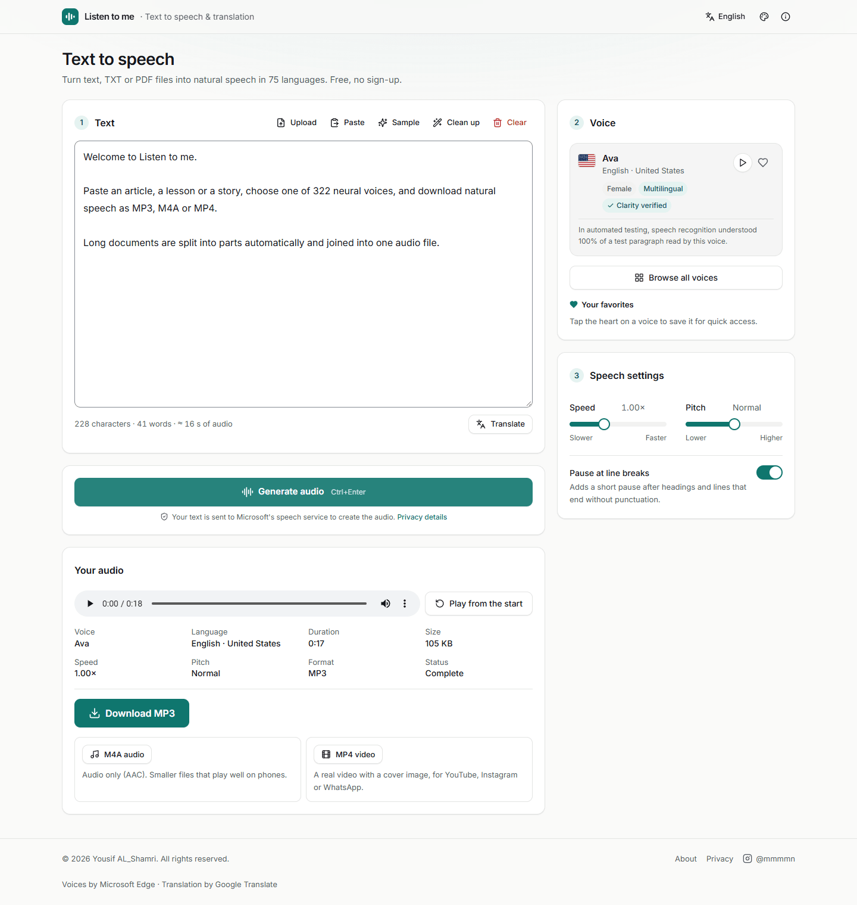
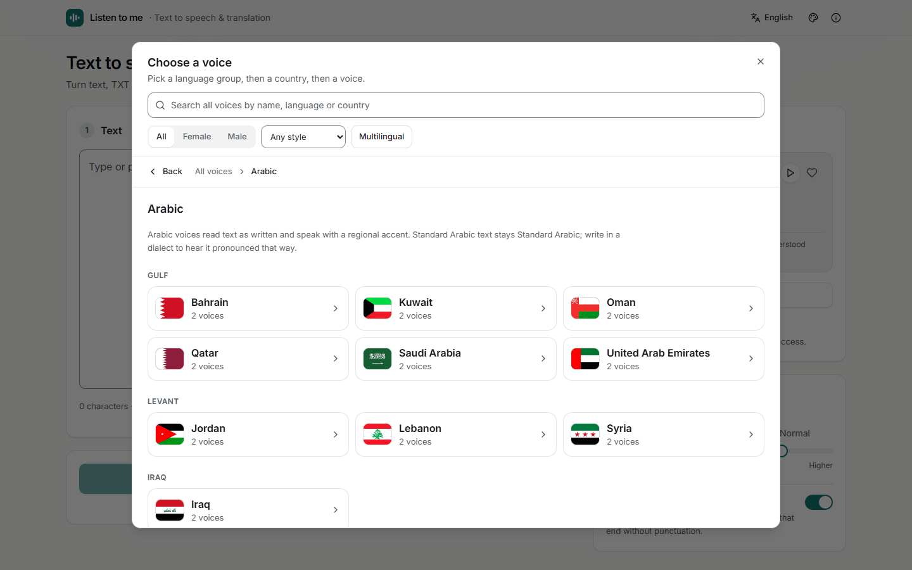
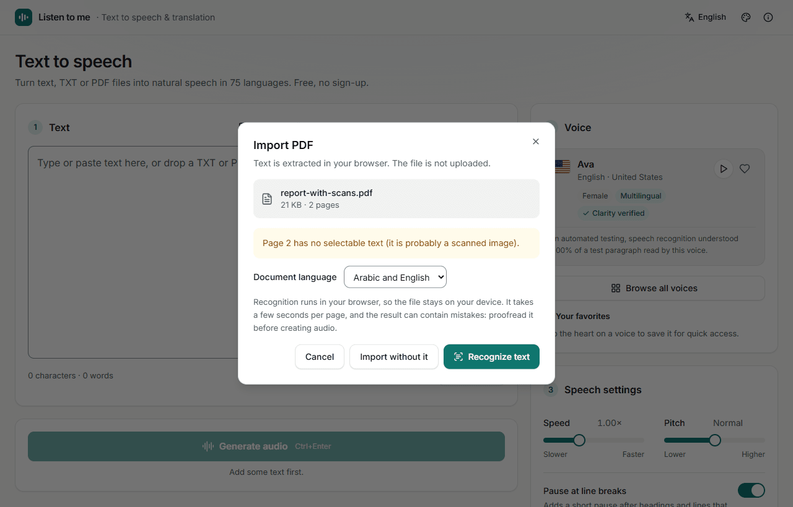
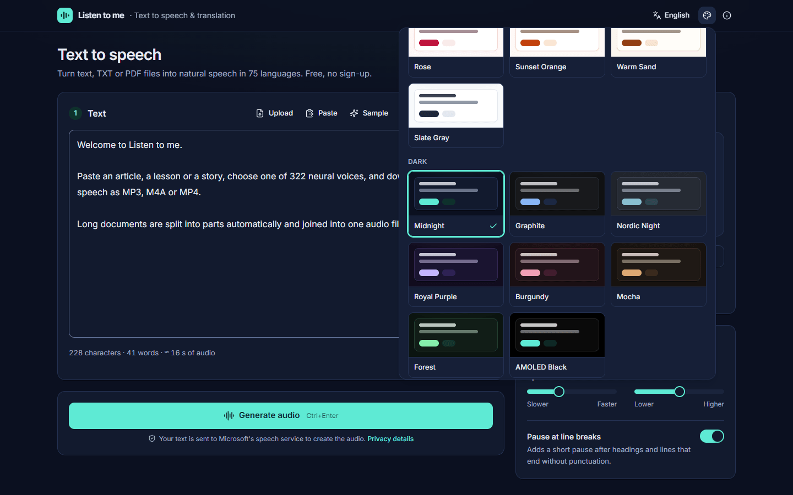
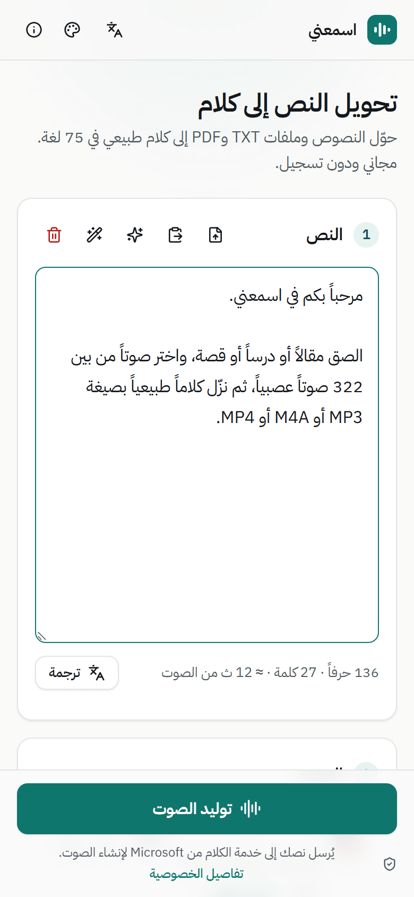

# Listen to me · اسمعني

**Multilingual text-to-speech and translation, running on your own computer.** Type, paste or upload text (TXT, PDF, or scanned PDF through built-in OCR), translate it if you like, pick one of 322 neural voices in 75 languages, and download natural-sounding speech as MP3, M4A, or a real MP4 video.

Created and maintained by **Yousif AL_Shamri** · GitHub [@engshamri](https://github.com/engshamri) · Instagram [@mmmmn](https://www.instagram.com/mmmmn/)

The Arabic name اسمعني (*Asma'ni*) means “listen to me”.

> العربية: راجع [README-AR.md](README-AR.md) لدليل التشغيل الكامل باللغة العربية.



<table>
  <tr>
    <td width="50%"></td>
    <td width="50%"></td>
  </tr>
  <tr>
    <td width="50%"></td>
    <td width="50%" align="center"></td>
  </tr>
</table>

---

## Project status

Working and tested locally on Windows 11 (see [Testing](#testing)). It is designed as a **local or single-server application**: speech and translation use free, keyless public endpoints that can change or rate-limit without notice, so it is not yet suited to high-traffic public hosting. See [Limitations](#limitations).

## Features

| Area | What you get |
|---|---|
| **Editor** | Bounded, scrolling editor that stays stable with very long pasted text · character/word counts · estimated audio duration and number of parts · draft autosave and recovery after refresh · Clear with Undo · clean-up tools (tidy spaces, join PDF line breaks, remove links/emoji) · `Ctrl + Enter` to generate |
| **TXT import** | Drag and drop or file picker · UTF-8 (with or without BOM) and UTF-16 detected reliably · legacy Windows-1256 / Windows-1252 recognised and **flagged as a guess**, with a manual encoding picker · binary files rejected |
| **PDF import** | Text extracted **in the browser** (the file is never uploaded) · page count, page ranges, progress and cancel · right-to-left line ordering for Arabic/Hebrew · Arabic presentation forms normalised · clear messages for encrypted and damaged files |
| **Scanned PDFs (OCR)** | Pages without a text layer are detected and **never dropped silently**: you choose to recognize them or import without them · Tesseract OCR (Arabic, English, or both) runs **on your device** in a web worker; the engine and language data are served by this app, so no document or request goes to a third party · per-page progress, Stop, page limits and timeouts · pages with low recognition confidence are named so you can proofread them |
| **Translation** | Searchable list of 100+ target languages · automatic source detection with manual override · paragraph structure preserved · progress for long texts, cancel, Undo / restore original · suggests a matching voice afterwards |
| **Voice browser** | Hierarchical, flag-based navigation: language group (Arabic, English, European, Asian, African, Other) → country cards with SVG flags (Arabic countries grouped by accent region) → voice cards with language/accent, characteristics, preview, favorite and a clear selected state · breadcrumb and Back keep your place · search across the whole library that tolerates Arabic spelling variants (أ/ا, ة/ه, ى/ي, tashkeel) and demonyms (“Iraqi”, “عراقي”) · gender, style and multilingual filters · full-screen on phones |
| **Favorites** | Heart any voice; favorites appear as one-click chips next to the selected voice and in a Favorites view; saved in the browser, synced across tabs |
| **Voice quality** | All 322 voices audited with audio measurements, Whisper large-v3 speech recognition against same-language peers, and reliability tests: 307 verified, 10 audio-checked (languages the recognizer cannot evaluate), 2 kept with a documented flag, 3 disabled for failing most requests; 4 Inuktitut voices that never worked were repaired; verified voices carry a “Clarity verified” badge. See [docs/VOICE-QUALITY.md](docs/VOICE-QUALITY.md) |
| **Speech** | Language-aware sentence splitting (never cuts a word) · paragraph-aware chunking · pauses after headings · speed and pitch · 3 parts in parallel with ordered assembly · retries with back-off · resume from a failed part without regenerating finished parts · real cancellation (the server kills the synthesis process) |
| **Voice consistency** | No silent fallback. If the speech service fails, you choose: retry, keep the finished parts, or explicitly accept a backup voice; any part read by it is listed with the result |
| **Results** | One controlled player (never two sounds at once, no autoplay) · exact duration from the MP3 frames · size, voice, speed, pitch, status · MP3 download · M4A (audio-only AAC) and **MP4 video** (H.264 still cover + audio) on demand · descriptive, timestamped file names · session history (kept only in the tab) |
| **Interface** | English (default) and Arabic with full RTL · 18 themes (10 light, 8 dark) + System in a gallery of live previews; saved and server-rendered (no flash) · WCAG 2.2 AA contrast verified for every theme · responsive layout with a sticky Generate bar on phones · reduced-motion support |
| **Security** | Input validation (zod) · body-size caps · rate limits · cross-site request protection · concurrency caps for Python/ffmpeg · no shell execution · private temp directories deleted after each request · security headers |

## Quick start

**Requirements:** [Node.js 20.9+](https://nodejs.org) and [Python 3.9+](https://www.python.org/downloads/). Optional: [ffmpeg](https://ffmpeg.org) for M4A/MP4 export. Internet access is needed while generating speech or translating (OCR and PDF/TXT import work offline).

```bash
git clone https://github.com/engshamri/Listen_to_me.git
cd Listen_to_me
python server.py
```

On the first run the launcher installs the `edge-tts` Python package and the npm packages, builds the app, starts it on <http://localhost:3000> and opens your browser. Later runs start in seconds and rebuild only when the source changed. Stop it with `Ctrl + C`.

| Shell | Command |
|---|---|
| PowerShell | `python server.py` or `.\run.ps1` |
| Command Prompt | `python server.py` or double-click `start.bat` |
| Linux / macOS / WSL | `python3 server.py` or `./run.sh` |

Useful options:

```bash
python server.py --port 8080      # another port (a busy port is skipped automatically)
python server.py --host 0.0.0.0   # reachable from phones/other PCs on your network
python server.py --dev            # development mode with hot reload
python server.py --rebuild        # force a fresh production build
python server.py --check          # only check the environment
python server.py --help
```

### Installing ffmpeg (optional)

- Windows: `winget install Gyan.FFmpeg` (then open a new terminal)
- macOS: `brew install ffmpeg`
- Debian/Ubuntu/WSL: `sudo apt install ffmpeg`

### Manual setup (without the launcher)

```bash
python -m pip install -r requirements.txt
npm install          # also copies the pdf.js and OCR engine files into public/
npm run build
npm start            # http://localhost:3000
# or: npm run dev    # development server
```

If more than one Python is installed, point the app at the one that has `edge-tts`: set `PYTHON_BIN` (see `.env.example`).

## Configuration

Everything works without configuration. To change defaults, copy `.env.example` to `.env.local`. Available settings: site URL for social previews, Python/ffmpeg paths, concurrency, rate limits, the translation provider (Google's free endpoint or a self-hosted [LibreTranslate](https://libretranslate.com)), whether the opt-in backup voice is offered, and `TRUST_PROXY` for deployments behind a reverse proxy.

## Scripts

| Command | Purpose |
|---|---|
| `npm run dev` / `build` / `start` | Next.js development, production build, production server |
| `npm run lint` · `npm run typecheck` | ESLint and TypeScript checks (both run clean; the build does not ignore errors) |
| `npm test` | Unit tests (Vitest) |
| `npm run test:e2e` | Browser tests (Playwright + axe accessibility scans). Uses installed Microsoft Edge on Windows; elsewhere run `npx playwright install chromium` once |
| `npm run test:live` | End-to-end API checks against a running server (`BASE_URL=...`) |
| `npm run voices:refresh` | Re-download the provider's voice list and rebuild the catalog |
| `scripts/voice-qa/run_audit.py` | Voice quality audit (see docs/VOICE-QUALITY.md; needs its own venv: `pip install -r scripts/voice-qa/requirements.txt`, a GPU recommended) |
| `node scripts/generate-brand-assets.mjs` | Regenerate favicon, social image and video cover |

## Architecture (short)

```
python server.py  (launcher: checks, installs, builds, supervises Next.js)

Browser (React 19, Next.js App Router)
  ├─ Editor, TXT/PDF import (pdf.js worker), OCR (tesseract.js worker), translation UI
  ├─ Voice library (static catalog + /api/preview)
  └─ Generation engine: chunk → POST /api/tts ×N (3 in parallel) → join MP3
Next.js route handlers (Node.js)
  ├─ /api/tts        → scripts/edge_synth.py (edge-tts) | opt-in backup voice
  ├─ /api/preview    → cached sample per voice (.cache/previews)
  ├─ /api/translate  → Google Translate (free endpoint) or LibreTranslate
  ├─ /api/convert    → ffmpeg: M4A audio or MP4 video
  └─ /api/health     → what this installation supports
```

Details: [docs/ARCHITECTURE.md](docs/ARCHITECTURE.md).

## Testing

All of the following were run on Windows 11 (Node 24, Python 3.14, Microsoft Edge, ffmpeg 9) on 2026-10-26, except the multi-part audio check (2026-10-25; the speech pipeline has not changed since). Commands and coverage: [docs/TESTING.md](docs/TESTING.md).

| Suite | Result |
|---|---|
| `npm run typecheck`, `npm run lint`, `npm run build` | clean, no errors or warnings |
| `npm test` (unit) | 115 passed |
| `npm run test:e2e` (browser, incl. axe WCAG 2.2 A/AA scans, live generation, OCR) | 51 passed |
| `npm run test:live` (API against a running server, real speech/translation/ffmpeg) | 25 passed |
| Multi-part audio check (4-part Arabic, 3-part English): decoded with ffmpeg, transcribed with Whisper large-v3 | no decode errors, no gaps > 1.2 s at part boundaries, 98.1 % / 99.2 % of source words recovered in order |
| `npm audit` | 0 vulnerabilities |

Automated tests cannot judge how natural a voice sounds; docs/TESTING.md includes a short listening protocol for that.

## Privacy

- To create audio, text is sent to Microsoft's Edge text-to-speech service; translation sends text to Google Translate (or your LibreTranslate server). The interface says so next to the Generate button and in **About → Privacy**.
- TXT and PDF files are read in the browser and never uploaded. OCR also runs in the browser.
- The server keeps no copies of text or audio: each request uses a private temporary folder that is deleted when it finishes. Only voice previews (fixed sample sentences) are cached.
- Drafts, settings, theme and language live in your browser (local storage / cookies).

## Security notes

- Every API input is validated; voices must exist in the catalog; speed/pitch are range-checked.
- Request bodies are capped (`/api/tts` 64 KB, `/api/translate` 256 KB, `/api/convert` 60 MB) and rate-limited.
- **Cross-site protection:** requests that browsers mark as coming from another website (`Sec-Fetch-Site`, `Origin`) are refused with 403, so a web page you visit cannot use your local server.
- **Proxy headers are not trusted by default:** without `TRUST_PROXY=true`, `X-Forwarded-For` is ignored (it could be forged to dodge rate limits) and all callers share one budget. Behind a reverse proxy that sets these headers, enable `TRUST_PROXY` for per-client limits.
- Python and ffmpeg run with argument arrays (never a shell), with timeouts, concurrency caps and cancellation.
- `/api/convert` only accepts MP3 data; uploaded documents never reach the server.
- PDF and OCR work have size, page-count and per-page time limits (50 MB, 500 pages per extraction, 50 pages per OCR run).
- The rate limiter is in memory (bounded): suitable for one local or single-instance deployment; use a shared store for several instances.

## Limitations

- **Free, keyless endpoints.** Speech uses Microsoft Edge's read-aloud service through `edge-tts`; translation uses Google Translate's web endpoint. They are not official, paid APIs: they can be slow, rate-limited, or change without notice. For a public, high-traffic deployment, use an official provider.
- **Voices are synthetic** and translations are machine-generated; neither is guaranteed to be perfect.
- **Arabic regional voices** add an accent; they do not convert Modern Standard Arabic into a dialect. Only two voices in the catalog are tagged by the provider as dialect voices (Liaoning and Shaanxi Mandarin).
- **Coverage** is what the provider offers today: 322 voices, 75 languages (checked against the live list on 2026-10-25; no voices were added or removed upstream). The 12 multilingual voices can read many more languages, with varying quality.
- **OCR** ships with Arabic and English language data only. Accuracy depends on scan quality; recognized text should be proofread. It runs at a few seconds per page on a typical laptop.
- **Backup voice** (opt-in) speaks with a single generic voice per language and ignores speed and pitch.
- **Development tooling:** ESLint stays on 9.x (in upstream maintenance) because plugins bundled with Next.js 16's lint config (`import`, `jsx-a11y`, `react`) do not yet support ESLint 10. It is a development-only tool with no known vulnerability.

## Troubleshooting

| Problem | Fix |
|---|---|
| `python` is not recognised | Reinstall Python and tick **Add python.exe to PATH**, or use `py server.py` |
| `Node.js is not installed` | Install the LTS version from nodejs.org and open a new terminal |
| “Speech engine isn't installed” banner | Run `python server.py` (it installs `edge-tts`), or `python -m pip install -r requirements.txt` |
| M4A/MP4 buttons are disabled | Install ffmpeg and restart |
| Port 3000 is busy | The launcher picks the next free port automatically, or use `--port 8080` |
| “The speech service didn't respond” | Check your internet connection and press **Retry**; finished parts are kept |
| Strange characters after importing a TXT | Choose another encoding in the file bar above the editor |
| PDF import or OCR does nothing after a manual install | Run `npm install` (or `node scripts/copy-vendor-assets.mjs`) to copy the engine files into `public/` |
| API calls return 403 behind a reverse proxy | Set `TRUST_PROXY=true` so the public host name from `X-Forwarded-Host` is used |
| PowerShell blocks `run.ps1` | `Set-ExecutionPolicy -Scope Process -ExecutionPolicy Bypass`, or just run `python server.py` |

## Support and contact

- Bug reports and questions: [GitHub Issues](https://github.com/engshamri/Listen_to_me/issues)
- Maintainer: Yousif AL_Shamri ([@engshamri](https://github.com/engshamri) on GitHub, [@mmmmn](https://www.instagram.com/mmmmn/) on Instagram)

## License

Copyright © 2026 Yousif AL_Shamri. **All rights reserved.** This repository is public so the code can be viewed; it is **not** released under an open-source license. No permission is granted to copy, modify, distribute or use it commercially without prior written permission from the copyright holder. See [LICENSE](LICENSE).

Third-party components keep their own licenses (Next.js, React, pdf.js, tesseract.js and its language data, edge-tts, flag-icons, Radix UI, and others).
